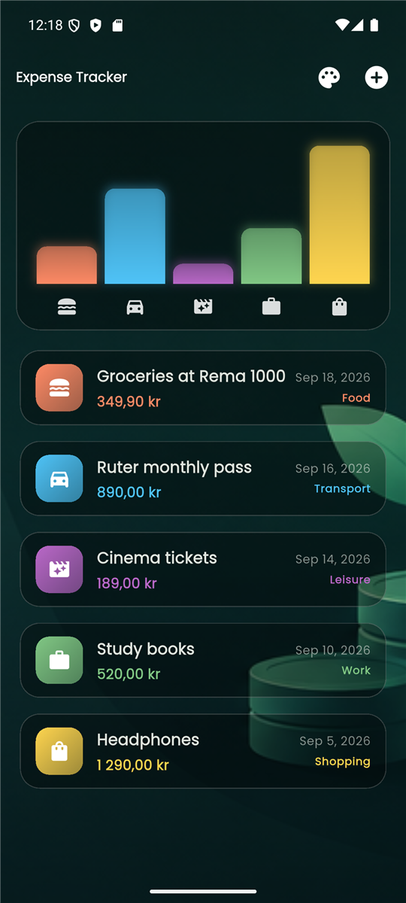
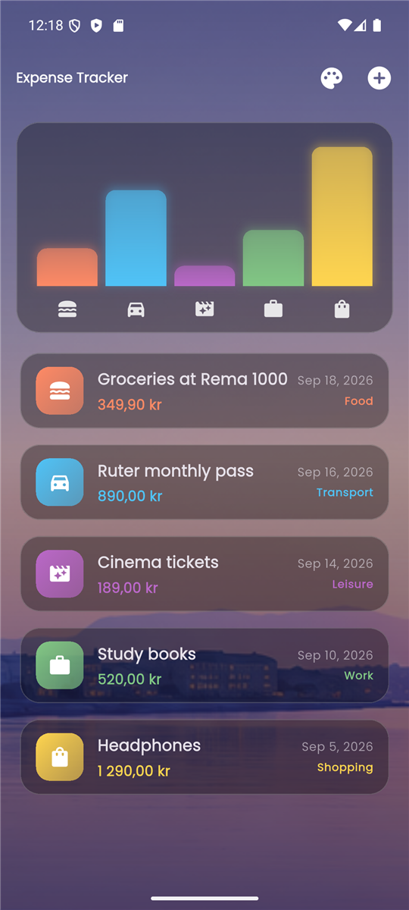
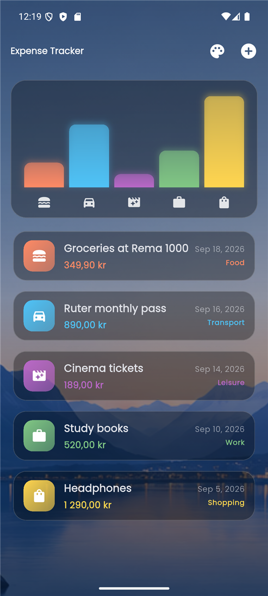
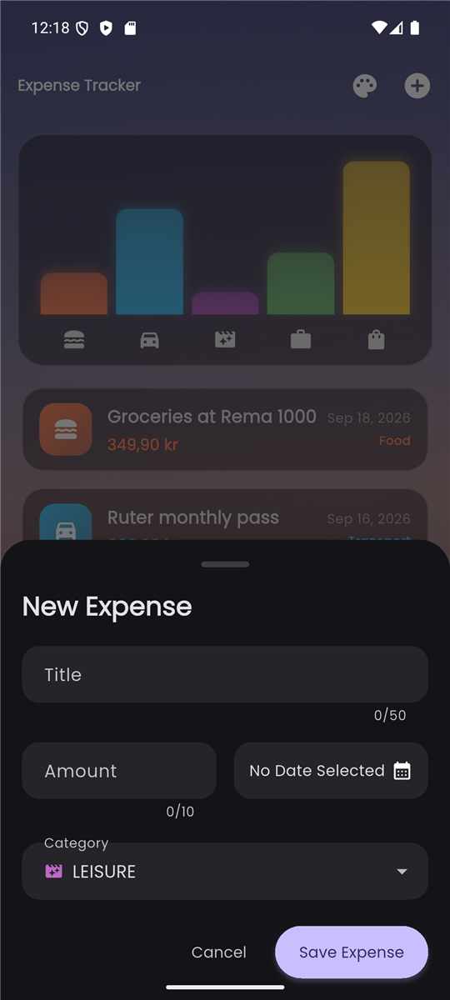
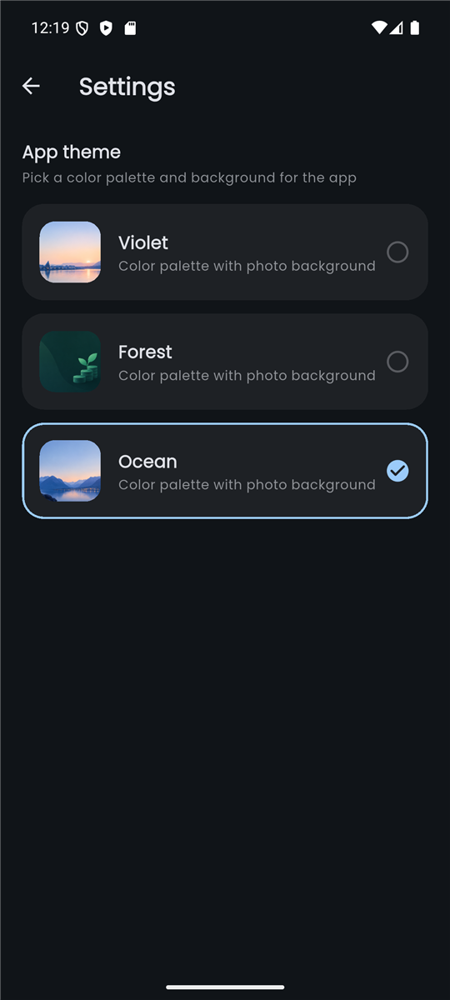

# Expense Tracker

A Flutter app for tracking personal expenses, built for the NTNU *Mobile Applications* course (Assignment #2).
Add expenses, see where your money goes in a chart and a list, and pick one of three themes with photo backgrounds.
Amounts are shown in Norwegian kroner (NOK).

<p align="center">
  
  
  
</p>

<p align="center">
  
  
</p>

## Features

| Assignment requirement | How it is done |
| --- | --- |
| Toolbar with an "Add" button | AppBar with a `+` button that opens the form |
| Expense data model (title, amount, date, category) | `Expense` class with a `Category` enum |
| Add expenses in a modal overlay, Save / Cancel | `NewExpense` form in a modal bottom sheet |
| Date picker | Material `showDatePicker` (future dates not allowed) |
| Input validation | "Invalid input" dialog for empty title, amount <= 0 or missing date |
| List and chart | Animated `AnimatedList` plus a bar chart per category |
| Data persists across restarts | `shared_preferences` (expenses stored as JSON) |
| Theming | Material 3 theme built from a seed color; 3 selectable themes saved on the device |
| Responsive, portrait and landscape | Stacked layout on phones, chart and list side by side on wide screens |
| Interactive elements | Buttons, swipe to delete with Undo, tappable chart bars, theme picker |

Extras: NOK formatting (`1 290,00 kr`), photo backgrounds with translucent "glass" cards, page and list animations.

## Project structure

```
lib/
├── main.dart                     App entry point, MaterialApp, theme wiring
├── models/
│   └── expense.dart              Expense, Category, ExpenseBucket, formatMoney
├── services/
│   └── expense_storage.dart      Save / load expenses (SharedPreferences)
├── theme/
│   ├── app_theme.dart            Theme presets and buildAppTheme()
│   └── theme_controller.dart     ThemeController (ChangeNotifier) and ThemeScope
└── widgets/
    ├── expenses.dart             Main screen: owns the state, add / delete / undo
    ├── new_expense.dart          Add-expense form with validation
    ├── settings_screen.dart      Theme picker
    ├── chart/
    │   ├── chart.dart            Bar chart of totals per category
    │   └── chart_bar.dart        One animated bar
    └── expenses_list/
        ├── expense_item.dart     One expense card
        └── expenses_list.dart    AnimatedExpenseRow: swipe-to-delete + list animation
assets/images/                    Photo backgrounds for the themes
docs/screenshots/                 Screenshots used in this README
test/widget_test.dart             Widget tests
```

## How it works

**Data flow.** The `Expenses` screen keeps the list of expenses in its state (`_registeredExpenses`).
`NewExpense` does not save anything itself: when the input is valid it calls the `onAddExpense` callback,
and `Expenses` adds the expense, plays the list animation and saves everything through `ExpenseStorage`.
The chart and the list both read from the same list, so they always agree.

**Main classes**

- `Expense` – the data model (id, title, amount, date, category) with `toJson` / `fromJson` for saving.
- `ExpenseBucket` – all expenses of one category; the chart draws one bar per bucket.
- `ExpenseStorage` – `loadExpenses()` and `saveExpenses()`; the list is stored as one JSON string.
- `Expenses` – the main screen (StatefulWidget). Key methods: `_addExpense`, `_removeExpense` (with Undo), `_showCategoryTotal`.
- `NewExpense` – the form. `_submitExpenseData` validates and creates the expense.
- `Chart` / `ChartBar` – bar heights are each category total divided by the largest total.
- `ThemeController` – remembers the selected theme and notifies listeners; `ThemeScope` gives any widget access to it.
- `AppThemePreset` and `buildAppTheme()` – one seed color plus an optional photo background per theme.

**Theming.** `buildAppTheme` creates the whole Material 3 theme (colors, fonts, buttons, cards, inputs) from one seed color,
so every widget stays consistent. Selecting a theme in Settings updates `ThemeController`, which rebuilds the app and saves the choice.
Themes with a photo background always use dark mode so the translucent cards stay readable.

**Responsive layout.** In `Expenses.build`, a width above 600 logical pixels puts the chart and list side by side; otherwise they are stacked.

## Run the app

Requirements: Flutter SDK (Dart 3.13+).

```bash
flutter pub get
flutter run
```

Run the tests and static analysis:

```bash
flutter test
flutter analyze
```

**Windows note.** If the Android build fails in `compileDebugKotlin` with "this and base files have different roots",
the project and the Pub cache are on different drives. `android/gradle.properties` already sets `kotlin.incremental=false` to avoid this.

## Built with

- Flutter (Material 3) and Dart
- [`shared_preferences`](https://pub.dev/packages/shared_preferences) – persistence
- [`intl`](https://pub.dev/packages/intl) – date and NOK formatting
- [`uuid`](https://pub.dev/packages/uuid) – unique expense ids
- [`google_fonts`](https://pub.dev/packages/google_fonts) – Poppins font
